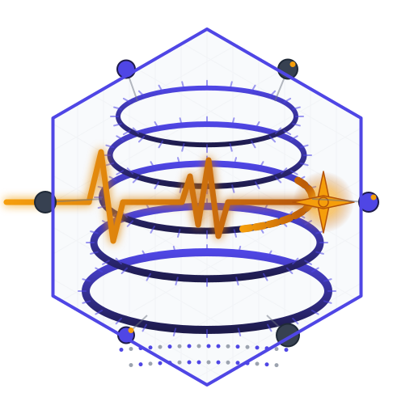
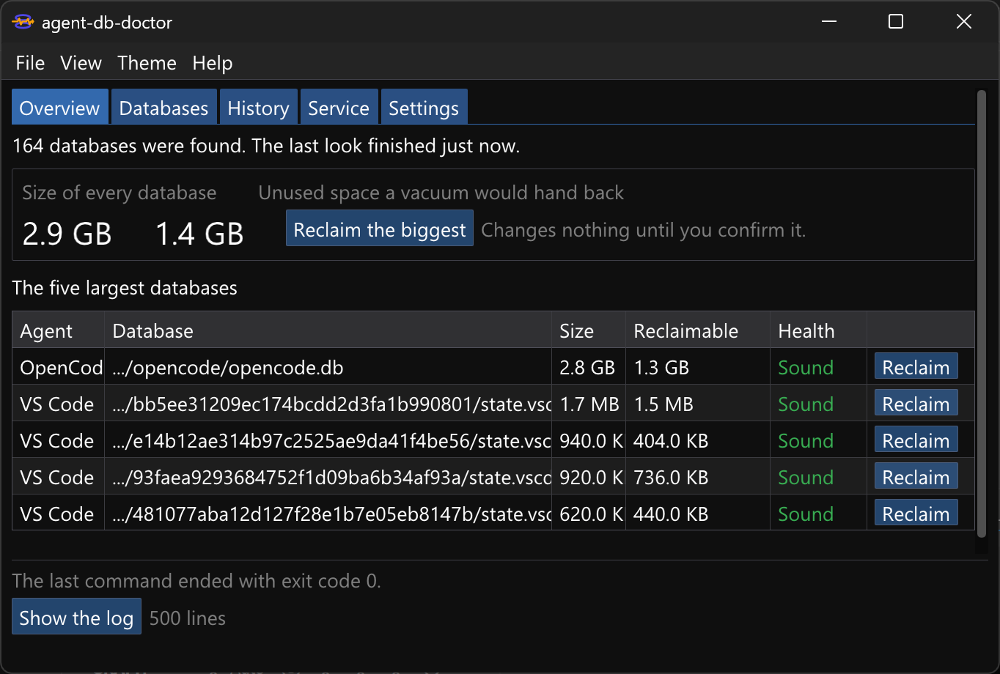
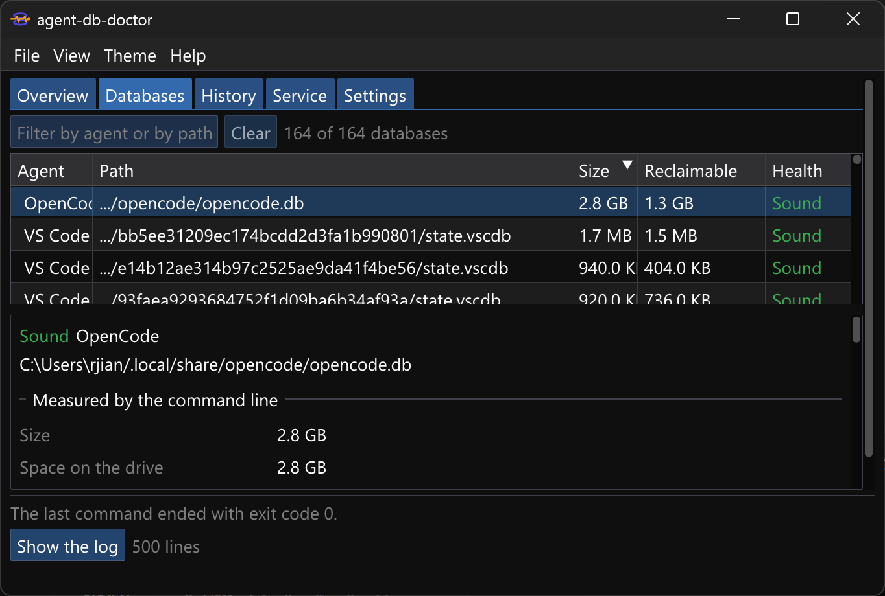
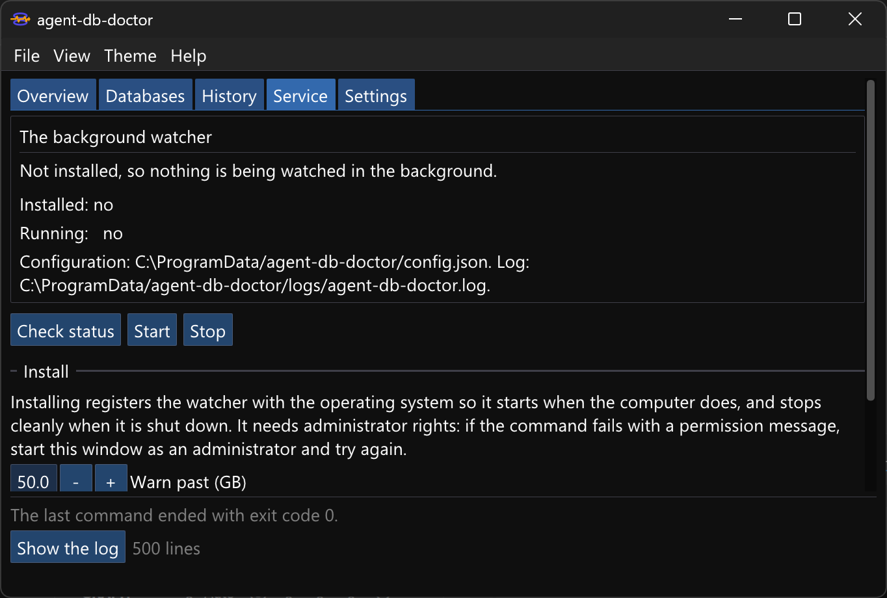

# agent-db-doctor



**A doctor for AI coding agent databases. Diagnose, compact, and recover.**

[](https://github.com/richie-rich90454/agent-db-doctor/actions/workflows/ci.yml)
[](LICENSE)


AI coding agents keep your work in local SQLite databases and JSONL files. They are
built for streaming, not for keeping: every partial response, every tool call, and
every edit is written as a full snapshot. A developer watching their OpenCode
database saw it grow from **40 GB to 124 GB in three weeks**, unnoticed, until
their disk was 96% full. When they tried to reclaim the space they made it worse,
and by the end **every session from three weeks was unrecoverable**.

This tool exists so that the next person does not lose theirs. It runs entirely on
your machine: no account, no telemetry, and no network access from the built
program.

---

## The 90 second version

```bash
# 1. See what you have. Nothing is changed, and the pass is measured in
#    milliseconds and kilobytes, not minutes and gigabytes.
agent-db-doctor look

# 2. Ask why one database is as large as it is, and where its bytes are.
agent-db-doctor why --database ~/.local/share/opencode/opencode.db

# 3. Give a target amount of space back: compaction first, then the vacuum,
#    each with its own safety copy and its own check.
agent-db-doctor reclaim --database ~/.local/share/opencode/opencode.db --target 20GB

# 4. Keep a copy of one conversation as Markdown before deciding anything.
agent-db-doctor export --database ~/.local/share/opencode/opencode.db --session <id> --output session.md
```

On a real 10.9 GB OpenCode database, the compact-then-vacuum flow removed
**415,856 redundant snapshots**, left all **479 sessions untouched and verified**,
and handed **8.3 GB (76.3%) back to the drive**. The check that follows the deletion
re-reads the oldest sessions and takes the safety copy back if anything is missing.
The vacuum itself was verified on the same file: 10.89 GB to 2.58 GB, structurally
sound afterwards.

---

## What you get

| | |
|---|---|
| **A diagnostic pass that reads nothing** | 13 ms on a 100 GB database, 2 file system queries, and fewer than 64 KB read. The byte count is not a promise: it is counted through SQLite's own file layer and asserted by the test suite, and you can see it yourself with `--trace-reads`. |
| **Answers, not just numbers** | `why` ranks the causes of a database's size; `explain-space` divides the bytes between tables, indexes, and the largest conversations, from SQLite's own page accounting; `history` turns the watchdog's hourly record into a rate and a forecast. |
| **A health score** | Every diagnosis carries a score from 0 to 100, printed as `Health: 78 of 100` and called `healthScore` in the machine readable output (-1 when it cannot be computed). Damage, warnings, unused space, and growth each reduce it, and a healthy idle database scores 100. It is the headline number in the window. |
| **Event log compaction** | The operation Kafka calls log compaction, for the one agent whose event log layout is documented: keep the newest snapshot of every message, remove the older copies, keep every word of the conversation. |
| **A reclaim target** | `reclaim --target 20GB` works out the cheapest safe sequence, shows the plan, asks once, and reports what the drive actually got back. |
| **Vacuuming for every SQLite agent** | Seven agents keep SQLite databases now, and giving unused space back needs no knowledge of a schema, so it is offered for all seven. A database set up for incremental auto-vacuum hands its pages back in place, with no second file and no scratch space. |
| **Session tools** | `sessions` ranks conversations by the payload they store, `export` writes one out as Markdown, JSON, or HTML, and `sessions delete` removes one with the same copy, typed yes, and sampled check every destructive command uses. |
| **A safety copy that is honest** | Made before anything changes, verified after, and removed again once the check passes so it cannot cancel out the space the run reclaimed. `--keep-backup` keeps it. A failed check puts it back, for real, and re-checks the result. |
| **A restore drill** | `backups verify` copies a backup to a scratch file, opens it, runs the integrity check, counts its sessions, and removes the scratch file. A copy you cannot restore is not a safety net. |
| **Machine readable output** | `--machine-readable` turns every report into one JSON object per line: every number the commands carry, typed, with a final exit object. The graphical interface reads the same objects. |
| **A shareable report** | `diagnose --report report.html` writes one standalone page with every number and warning, ready to attach to an issue. |
| **Watchdog monitoring** | A system service (systemd, launchd, or the Windows service manager) that measures every database once an hour with one metadata call each, records the sizes and the schema layouts, and logs when a threshold is crossed. With `allowAutomaticCompaction` set, globally or for one database through `databasePolicies`, it also compacts and then vacuums a database that is above its critical threshold, idle, and unlocked, and it attempts a desktop notification when a threshold is crossed and after automatic maintenance. |
| **An audit log** | Every destructive run, and every step automatic maintenance takes, is appended to an audit log beside the service configuration: the time, the action, the path, the sizes before and after, the safety copy, the outcome, and the exit code. `audit` prints its tail, with `--limit` for a shorter view. |

## What makes it safe

Every destructive operation does the same things, in this order, and a failure at
any step stops before the next one begins:

1. **Refuses to run** if the message text might live only in the rows it is about
   to delete, if another process has a change in progress, or if the database is
   damaged.
2. **Copies the file**, including the side files, as a file system clone where the
   platform supports one, and prints where the copy is.
3. **Asks**, in plain language, and treats anything other than an exact `yes` as no.
4. **Deletes in batches** inside transactions, checking every batch, so an
   interruption leaves a consistent database. The test suite kills a compaction
   partway through and checks exactly that.
5. **Verifies afterwards** that the oldest sessions still hold their text, and puts
   the copy back if they do not, then checks the restored database again.

The vacuum is built the same way: a new file is written beside the original, checked
with SQLite's own integrity check, and only then swapped in. The swap is journaled,
so a power loss between any two of its steps is detected and resolved on the next
run. The original is moved aside rather than deleted, and its side files move with
it.

The full story is in [docs/safety.md](docs/safety.md).

## Your data, your responsibility

The tool is careful, and it is still your data.

It copies before it changes, checks afterwards, and puts the copy back when a check
fails. That is a safety net for the length of one operation, not a backup system: the
copy sits on the same disk as the database it protects, and it is removed once the
check passes unless you ask for `--keep-backup`.

So keep your own backups of anything you cannot lose, and try the tool on a copy
first if a database holds the only record of something. `export` and `backups` exist
to make that easy.

Nothing here comes with a warranty. The tool is provided under the MIT license, as
is, without warranty of any kind, and you run it on your own data at your own risk;
the license is the whole of the agreement between us. If a database matters, copy it
before you let anything touch it.

What the tool will not do is touch anything else. It reads the databases it finds
and the files it needs, and it writes in exactly three places: beside a database it
changes, which is the safety copy; the watchdog's own folder, once you install the
service; and wherever you point an output flag. It makes no network requests, so
there is no account, no telemetry, no update check, and no crash reporting. The one
outbound action is a desktop notification, handed to your own notification program,
and only when a policy asks for one.

---

## Installation

Each release carries a prebuilt package for Windows (x86_64), macOS (Apple
silicon), and Linux (x86_64): unpack it and run the binary beside the libraries it
carries. Both the command line program and the window are in it.

From source:

```bash
git clone https://github.com/richie-rich90454/agent-db-doctor
cd agent-db-doctor
cmake -S . -B build -DCMAKE_BUILD_TYPE=Release
cmake --build build
```

The binary lands at `build/bin/agent-db-doctor`. Put it somewhere on your path.
The winget manifest templates and the Homebrew tap formula template are prepared
in `packaging/`, with generators that fill in the release URL and the SHA-256;
neither has been submitted yet, so `winget install` and `brew install` do not work
until they are.

<details>
<summary>Requirements</summary>

| Requirement | Version |
|---|---|
| Compiler | GCC 13+, Clang 16+, or MSVC 19.36+ |
| CMake | 3.24 or newer |
| Standard | C++23 |
| Network | Needed once, at configure time, to fetch the five dependencies |

Everything else is vendored, and every download is pinned by hash or by commit.

</details>

## Commands

| Commands | What they do | Changes your data? |
|---|---|---|
| `diagnose`, `look` | Reports size, contents, and health | No |
| `explain-space` | Divides the bytes between tables, indexes, and conversations | No |
| `history` | The recorded growth, and when the drive would fill | No |
| `why` | Ranks the causes of one database's size | No |
| `export` | Writes one session out as Markdown, JSON, or HTML | No |
| `watch` | A live table of every database, from metadata only | No |
| `sessions` | Lists conversations, or deletes one after copying and checking | `delete` only |
| `compact` | Event log compaction: removes redundant snapshots | Yes, after a copy and a confirmation |
| `vacuum` | Hands unused pages back, in place when the database is set up for it | Yes, after a copy and a confirmation |
| `reclaim` | Reaches a space target by composing compaction and vacuum | Yes, after a copy and a confirmation |
| `recover`, `rescue` | Explains what is wrong and what can be fixed | Only with `--rebuild` |
| `backups` | Lists, verifies, restores, or deletes safety copies | `restore` and `delete` only |
| `service` | Installs and controls the background watchdog | No |
| `audit` | Shows the record of destructive runs and automatic maintenance | No |
| `agents` | Lists every supported agent and where its data was found | No |

Every flag is documented in [docs/cli-reference.md](docs/cli-reference.md), and the
exit codes are part of the contract: `0` for success, `1` for a refusal or a
problem, `2` for a mistake in the command line.

## Machine readable output

```bash
agent-db-doctor diagnose --database ~/.local/share/opencode/opencode.db --machine-readable --quiet
```

```json
{"event":"database","path":"...","agent":"OpenCode","sizeBytes":3045969920,"pageCount":743645,"freePageCount":362934,"reclaimableBytes":1486577664,"journal":"wal","autoVacuum":false,"compactionSupported":true,"schema":"second generation rows only; the older duplicate snapshots are absent","integrity":"not_checked","rows":{"session":{"count":536,"approximate":false}},"warnings":[...],"nextSteps":[...]}
{"event":"exit","exitCode":0}
```

One object per line, flushed as it is written, so a script can follow a long
operation. The full schema is in [docs/json-api.md](docs/json-api.md).

---

## The window

The window is a thin invoker: it runs the `agent-db-doctor` binary that sits
beside it, streams its output, and reads the same machine readable JSON, so the
window and the command line cannot disagree about a number. It is built as a
windows-subsystem application, and every command it runs starts with no console
window.

Five tabs, one primary action each:

| Tab | What it holds |
|---|---|
| Overview | The total size and the total reclaimable across every database, one "Reclaim the biggest" button, and the five largest databases. |
| Databases | A filter box and a sortable table of agent, path, size, reclaimable, and health. The drawer for the selected database shows its metrics, warnings, and suggested next steps, and holds its actions: Reclaim, Preview compaction, Preview vacuum, Recovery plan, Backups, Sessions, Export session, and Diagnose, with an optional full integrity check. |
| History | The growth the watchdog recorded, and its forecast. |
| Service | The real status (installed, running, the state sentence, the locations, and the most recent log line) and the install, start, stop, and uninstall buttons with the threshold and interval fields. Installing needs administrator rights. |
| Settings | The default reclaim target, whether the safety copy is kept, a backup destination, and the resolved path of the command line program. |

A running command shows a progress bar with a Cancel button, and its result
appears in an opaque, scrollable dialog. A destructive run always goes through a
preview or a plan first, and then a typed `yes`; a successful change rescans by
itself. The window's size, theme, and settings persist between runs.



The Overview tab. Total size and total reclaimable, the Reclaim the biggest
button, and the five largest databases.



The Databases tab. The filter box, the sortable table of agent, path, size,
reclaimable, and health, and the drawer for the selected database.



The Service tab. The real status, the locations, the most recent log line, and the
install, start, stop, and uninstall controls.

---

## Supported agents

Sixty two agents are supported: seven keep SQLite databases and are diagnosed and
vacuumed, and the rest keep text or configuration and are diagnosed and left alone.

| Agent | Database location | What the tool does |
|---|---|---|
| OpenCode | `~/.local/share/opencode/opencode.db` | Diagnose, compact the event log, vacuum |
| Cursor | platform-specific, one SQLite file per workspace | Diagnose and vacuum |
| VS Code | platform-specific, one `state.vscdb` per workspace | Diagnose and vacuum |
| Cline | `~/.cline/data/db/sessions.db` | Diagnose and vacuum |
| Windsurf | platform-specific data dir | Diagnose and vacuum |
| Zed | platform-specific user data dir | Diagnose and vacuum |
| Void | platform-specific data dir | Diagnose and vacuum |
| Codex CLI | `~/.codex/sessions/` (JSONL) | Diagnose only |

The other fifty four, with the path each one uses and what the tool may do to it,
are in [docs/agents.md](docs/agents.md). `agent-db-doctor agents --verify` prints
every candidate path on your machine, including the ones that were not found.

Only OpenCode stores redundant snapshots, so only OpenCode's event log is
compacted. Every SQLite database can be vacuumed, because giving unused space back
needs no knowledge of the tables' contents.

## Performance

Every number below is measured by the benchmark suite, and every one of them is an
assertion in `tests/benchmark/`, so a regression fails the build rather than
quietly arriving in a release.

| Measurement | Target | Measured | How |
|---|---|---|---|
| Diagnostic pass, 100 GB database | < 500 ms | **13 ms** | `DiagnoseBenchmark` |
| Whole `diagnose` command on that file, process start included | < 500 ms | **29 to 41 ms** | measured over 3 runs |
| File metadata queries per diagnostic pass | < 20 | **2** | `DiagnoseBenchmark` |
| Bytes read from the database per pass | < 64 KB | **49 KB measured on a real 2.8 GB database**, counted through SQLite's own file layer | `DiagnoseBenchmark` |
| Metadata calls per watchdog tick, per database | 1 | **1** | `WatchdogBenchmark` |
| Memory growth over 1000 idle watchdog ticks | ~0 | **< 1 MB** | `WatchdogBenchmark` |
| Marginal cost of removing one redundant snapshot | 5.3 us | **8.0 us** Windows, **3.0 us** Linux | `CompactBenchmark` |

See [benchmarks/results.md](benchmarks/results.md) for the machine and the full
method.

---

## Documentation

| File | What is in it |
|---|---|
| [docs/index.md](docs/index.md) | The documentation home, and where to start |
| [docs/getting-started.md](docs/getting-started.md) | Install, first run, the four jobs |
| [docs/cli-reference.md](docs/cli-reference.md) | Every command, every flag, every exit code |
| [docs/json-api.md](docs/json-api.md) | The machine readable output contract |
| [docs/safety.md](docs/safety.md) | The guarantees, and how each one is enforced |
| [docs/agents.md](docs/agents.md) | All sixty two agents, and how to add one |
| [docs/faq.md](docs/faq.md) | Why not just delete the database, and other questions |
| [docs/architecture.md](docs/architecture.md) | How the code is put together |
| [docs/performance.md](docs/performance.md) | The performance contract, principle by principle |
| [docs/recovery-playbook.md](docs/recovery-playbook.md) | Every failure pattern the tool recognises |
| [docs/agent-adapters.md](docs/agent-adapters.md) | How each agent stores data, for contributors |
| [docs/system-service.md](docs/system-service.md) | The watchdog on each platform |
| [docs/integrations.md](docs/integrations.md) | The pipeline guard action and the Prometheus metrics |
| [docs/verification.md](docs/verification.md) | What continuous integration actually ran, generated from the run itself |
| [docs/roadmap.md](docs/roadmap.md) | What is planned next |
| [ACCESSIBILITY.md](ACCESSIBILITY.md) | What the project commits to, what is known not to work, and how to report a barrier |
| [CONTRIBUTING.md](CONTRIBUTING.md) | The one rule that is not negotiable, the style, and what will be declined |
| [benchmarks/results.md](benchmarks/results.md) | Measured numbers and the machine they came from |

## Integrations

A composite GitHub Action builds the command line program and runs `diagnose`, or
`reclaim --target`, as a pipeline guard: the step fails when a database needs
attention. `diagnose --prometheus` writes node_exporter textfile metrics, so a team
can chart every database it knows about. Both are documented in
[docs/integrations.md](docs/integrations.md).

Packaging is prepared but not published. `packaging/` holds the winget manifest
templates and the Homebrew tap formula template, with generators that fill in the
release URL and the SHA-256, and the steps for submitting them. winget takes a
manifest pull request to `microsoft/winget-pkgs`; the Homebrew formula goes to a
personal tap repository named `homebrew-tap`. Both are submitted at the next
tagged release; until one has been submitted, installation is from source.

## What this tool does not do

The list is here because knowing where a tool stops is more useful than being
surprised by it later.

**It does not compact any agent except OpenCode.** Only OpenCode produces redundant
snapshots, and inventing a deletion rule for another agent's undocumented tables
would be guessing with someone's history.

**It does not walk a directory tree.** Finding databases uses a fixed list of
candidate paths, one metadata call each.

**It does not check every page of a database over two gigabytes** unless asked with
`--check`, and it says so rather than skipping silently.

**It does not report an exact row count for a database that has never been
analysed.** The count comes from SQLite's statistics table, which is one indexed
read. When that table has never been populated, the report says the count is
unknown rather than spending minutes counting rows.

**It does not turn on filesystem compression, and it does not repair its effects.**
Compressing a live SQLite database is what caused the emergency this tool was
written for.

**It does not delete a safety copy that a failed run may need**, and it never
deletes a database file without an explicit confirmation and a copy.

---

## Contributing

See [CONTRIBUTING.md](CONTRIBUTING.md). The one rule that is not negotiable: nothing
you add may destroy a user's session history without their explicit confirmation.

Every change is built and tested by the workflow in `.github/workflows/ci.yml` with
GCC and Clang on Linux, MSVC on Windows, and AppleClang on macOS. The workflow
writes what it ran - job names, conclusions, times, and the run link - into
[docs/verification.md](docs/verification.md) and commits it on `main`, so the
record is generated from the runs rather than written by hand.

Releases are built by `.github/workflows/release.yml`. Publishing a release for a
tag starts it: it checks that the tag names the version in `CMakeLists.txt`, builds
the three platform packages with the same tests as continuous integration, attaches
them to that release, and signs them with cosign. The same workflow can be started
by hand: with no input it builds the packages and leaves them as run artifacts, and
with the tag of an existing release it attaches the packages and their signatures to
that release, which is how a release is completed after a run that failed. It moves
no tag and re-creates no release.

Accessibility reports are defects here, not feature requests:
[ACCESSIBILITY.md](ACCESSIBILITY.md) says what the project commits to, what is known
not to work, and how to report a barrier.

If this tool saved you a disk, a star helps the next person find it before their disk
is full.

## License

[MIT](LICENSE)

## Acknowledgements

- The SQLite authors, for the database engine this tool is built on and for
  `quick_check` and `VACUUM INTO`, which do the two hardest jobs here.
- The authors of OpenCode, Codex CLI, Claude Code, Cursor, Continue, and Aider,
  whose storage design created the problem.
- Everyone who has ever lost work to a full disk and had nobody to ask.

## Trademark disclaimer

OpenCode, Cursor, VS Code, Cline, Roo Code, Reasonix, Gemini, Windsurf, Zed,
GitHub Copilot, Warp, Kilo Code, Augment, Trae, PearAI, Amp, CommandCode, Pi,
Void, Tabnine, Cody, Codeium, Supermaven, Bito, CodeGPT, Blackbox, AskCodi,
Phind, IntelliCode, Tabby, Pieces, Amazon Q, Junie, Qoder, Lingma, Comate,
Droid, GitLab Duo, WorkBuddy, Kimi, Kiro, Qwen Code, CodeBuddy, MarsCode,
Qodo, Sourcery, Snyk, SonarQube, AnythingLLM, GPT4All, Jan, LM Studio,
Open WebUI, AIChat, gptme, LLM, ShellGPT, Raycast, and all other product names
mentioned here are trademarks of their respective owners. They appear in this
project for one purpose only: to identify where those programs keep their data
so this tool can find it. There is no affiliation with and no endorsement by
any of them, and the names are not used for any other purpose.
